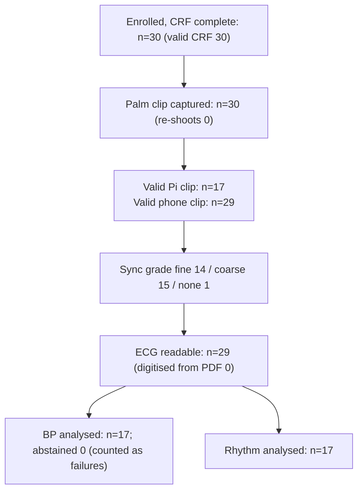

> Synthetic cohort: these pages measure the pipeline on generated data and are not study results.

# STARD flow (pilot)

## Exclusion reasons (Pi, first clip)

| reason | n |
|---|---|
| flicker_flag | 10 |
| sqi_flag | 5 |

Failed and abstained readings are failures in every coverage figure.
